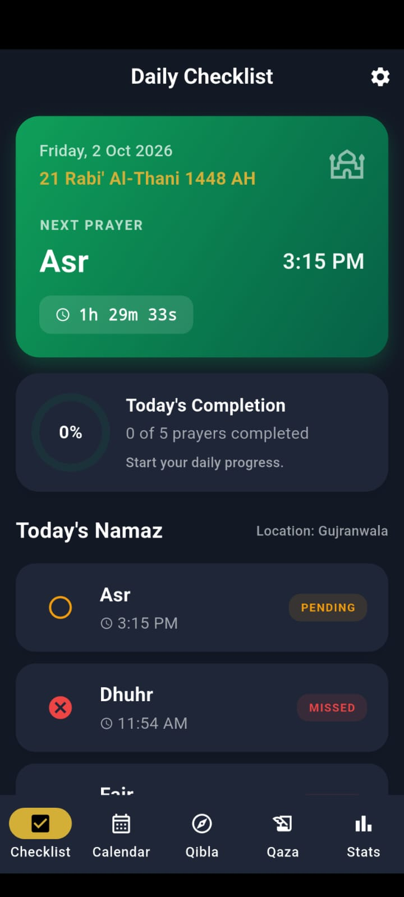
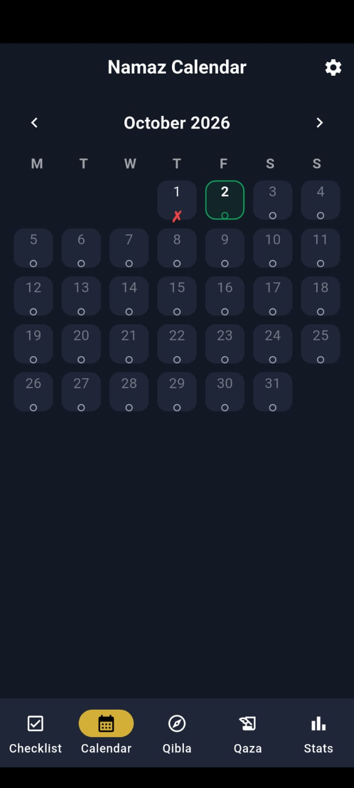
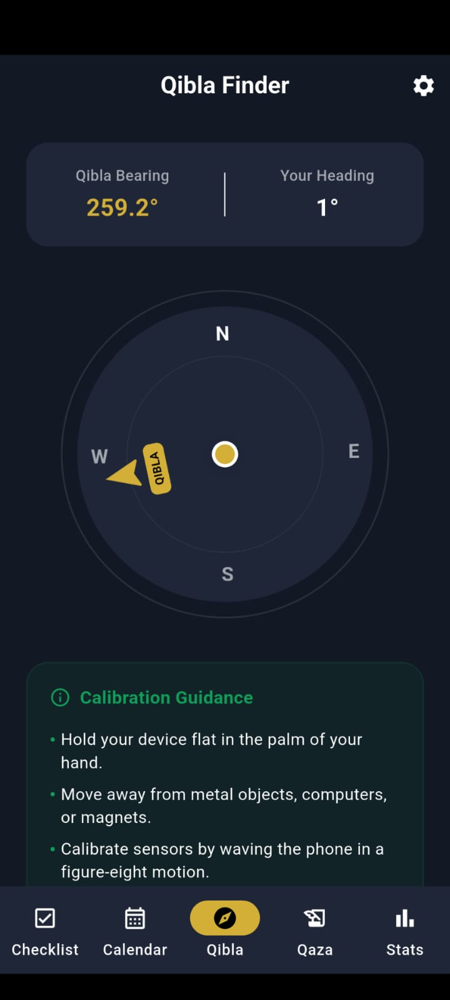
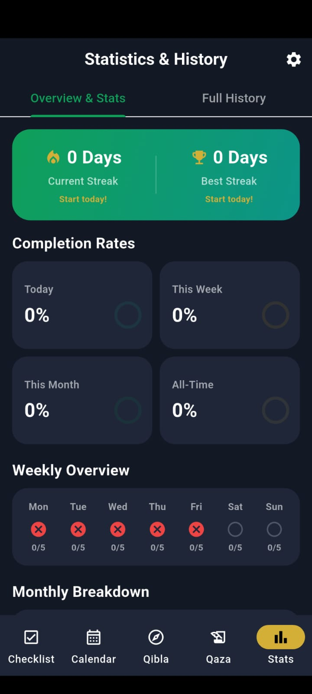
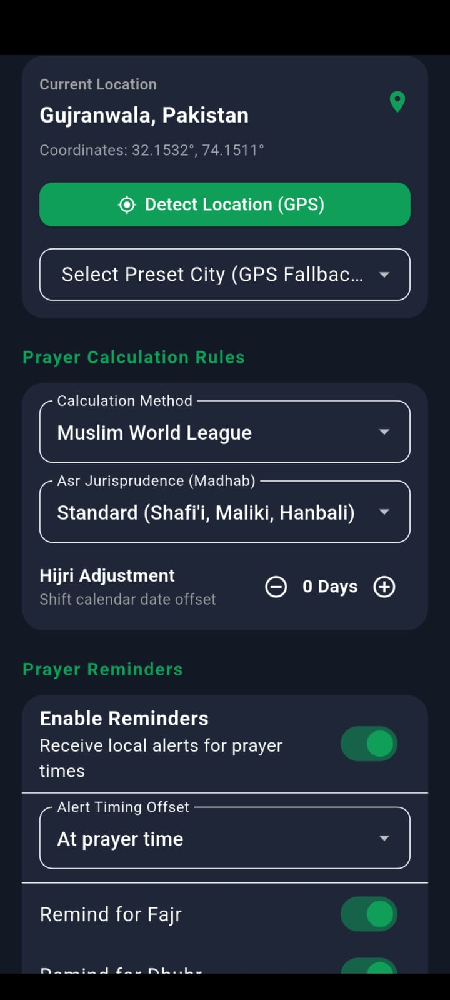

# 🌙 Namaz Companion (Namaz Calculator)

> **An offline-first, privacy-respecting Islamic prayer companion built with Flutter & Riverpod.**

[](https://flutter.dev)
[](https://dart.dev)
[](LICENSE)
[](CONTRIBUTING.md)
[](#privacy--architecture)

---

## 📸 Screenshots & UI Preview

| 📱 **Daily Checklist** | 📅 **Namaz Calendar** | 🧭 **Qibla Finder** |
| :---: | :---: | :---: |
|  |  |  |
| Log prayers with status (Adaa, Qaza, Jamaat, Late) | Monthly timetable with Hijri & Gregorian dates | Real-time magnetic sensor compass to Makkah |

<br>

| 📊 **Statistics & History** | ⚙️ **Settings & Calculation** |
| :---: | :---: |
|  |  |
| Streak counters, compliance charts & historical logs | Multiple calculation conventions & juristic methods |

---

## ✨ Features

- 📅 **Namaz Calendar & Timetable**: High-accuracy daily prayer times (Fajr, Sunrise, Dhuhr, Asr, Maghrib, Isha) combined with dual **Hijri and Gregorian** calendar views.
- ✅ **Daily Prayer Checklist**: Track daily prayers easily with status badges (**Adaa**, **Adaa with Jamaat**, **Late**, **Qaza**, **Missed**).
- 🧭 **Real-Time Qibla Compass**: Hardware magnetometer integration (`flutter_compass`) providing smooth heading updates, exact bearing relative to your GPS coordinates, and distance to Kaaba.
- 🧮 **Qaza-e-Umri Tracker**: Record and manage backlog missed prayers. Automatically estimates completion dates based on your daily logging target.
- 📊 **Statistics & Progress Insights**: Visual charts, prayer streak tracking, monthly completion rates, and historical logs to keep you consistent.
- 🔔 **Adhan & Local Notifications**: Timely local notifications before and at prayer times without requiring an internet connection.
- 🔒 **100% Offline & Privacy-Focused**: Zero network tracking, no analytics, no external ad servers. All personal logs and settings remain securely stored on your local device.
- 🎨 **Adaptive Theme & Book-Style Transitions**: Smooth page turn transitions (`BookPageView`) with full Light, Dark, and System theme support.

---

## 🛠️ Calculation Conventions & Madhab Support

Powered by the robust [`adhan`](https://pub.dev/packages/adhan) astronomical library:

| Calculation Method | Region / Authority |
| :--- | :--- |
| **Muslim World League (MWL)** | Worldwide default |
| **ISNA / North America** | Islamic Society of North America |
| **Umm Al-Qura** | Makkah, Saudi Arabia |
| **Karachi** | University of Islamic Sciences, Karachi |
| **Egyptian** | Egyptian General Authority of Survey |
| **Tehran** | Institute of Geophysics, University of Tehran |
| **Dubai / Kuwait / Qatar / Singapore / Turkey** | Official national calculation parameters |

**Juristic Methods (Asr Time):**
- 🟢 **Hanafi** (Later Asr shadow ratio)
- 🔵 **Shafi'i / Maliki / Hanbali** (Standard Asr shadow ratio)

---

## 🏗️ Architecture & Project Structure

The project follows a clean, feature-driven architecture using **Riverpod** for state management and **Hive** for fast, local object persistence.

```text
lib/
├── main.dart                  # App entry point, ProviderScope & Theme configuration
├── models/                    # Data models with Hive TypeAdapters
│   ├── app_settings.dart      # App preferences schema
│   ├── prayer_record.dart     # Daily prayer logs schema
│   └── qaza_record.dart       # Qaza backlog schema
├── providers/                 # Riverpod StateNotifier & Provider definitions
│   ├── prayer_provider.dart   # Daily checklist state
│   ├── qaza_provider.dart     # Qaza tracking state
│   ├── settings_provider.dart # Calculation & UI settings state
│   └── stats_provider.dart    # Historical analytics state
├── screens/                   # Main application screens
│   ├── daily_namaz.dart       # Daily checklist UI
│   ├── namaz_calendar.dart    # Monthly calendar & timetable
│   ├── qibla.dart             # Compass & location UI
│   ├── qaza.dart              # Qaza backlog counter & estimator
│   ├── statistics.dart        # Analytics & history tabs
│   └── settings.dart          # Configuration screen
├── services/                  # Business logic & hardware integrations
│   ├── location_service.dart  # GPS location & geocoding
│   ├── notification_service.dart # Local notifications manager
│   ├── prayer_time_service.dart # Adhan calculation wrapper
│   └── storage_service.dart   # Hive storage initialization & CRUD
├── utils/                     # Themes, constants, & helper functions
└── widgets/                   # Reusable UI widgets & custom page view animations
```

---

## 🚀 Getting Started

### Prerequisites

- [Flutter SDK](https://docs.flutter.dev/get-started/install) (`^3.12.2` or later)
- [Dart SDK](https://dart.dev/get-sdk) (`^3.0.0` or later)
- Android Studio / VS Code with Flutter extension
- Physical device or emulator (Note: Qibla compass requires a physical device with a magnetometer sensor).

### Installation & Setup

1. **Clone the repository:**
   ```bash
   git clone https://github.com/your-username/Namaz_Calculator.git
   cd Namaz_Calculator
   ```

2. **Install dependencies:**
   ```bash
   flutter pub get
   ```

3. **Generate Hive Adapters (if modifying models):**
   ```bash
   dart run build_runner build --delete-conflicting-outputs
   ```

4. **Run the application:**
   ```bash
   flutter run
   ```

---

## 📦 Building for Production

### Android

- **Build APK:**
  ```bash
  flutter build apk --release
  ```

- **Build App Bundle (AAB):**
  ```bash
  flutter build appbundle --release
  ```

### iOS

- **Build iOS App:**
  ```bash
  flutter build ios --release
  ```

---

## 🧪 Testing

Run unit and widget tests:

```bash
flutter test
```

---

## 🤝 Contributing

Contributions are welcome! If you find a bug or have a feature request, please open an issue or submit a pull request.

1. Fork the Project
2. Create your Feature Branch (`git checkout -b feature/AmazingFeature`)
3. Commit your Changes (`git commit -m 'Add some AmazingFeature'`)
4. Push to the Branch (`git push origin feature/AmazingFeature`)
5. Open a Pull Request

---

## 📄 License

Distributed under the MIT License. See `LICENSE` for more information.

---

<p align="center">Made with ❤️ for the Ummah</p>

